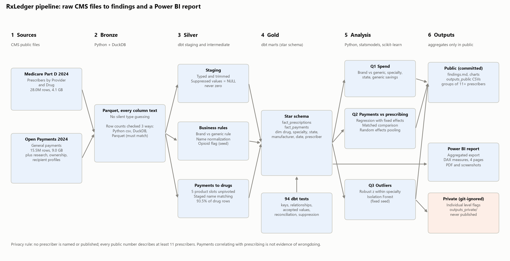

# RxLedger

**Medicare Part D drug spending and manufacturer payments to prescribers, 2024**

RxLedger joins two large public CMS datasets on the prescriber's NPI: what every
Medicare Part D prescriber prescribed and what it cost (28,023,892 prescriber x drug
rows), and every payment drug and device makers disclosed to prescribers (15,498,687
general payment records). A DuckDB and dbt pipeline turns the raw files into a tested
star schema; Python answers three business questions with regression, matching, and
robust outlier detection; and a Power BI report presents the results. Individual
prescribers are never published.

Author: **Erica Mathias**

## Headline numbers (2024)

| Measure | Value |
|---|---:|
| Medicare Part D drug cost | $226.7 billion |
| Part D claims | 1.48 billion |
| Prescribers | 1,139,455 |
| Generic share of claims / of cost | 88.5% / 12.5% |
| Estimated generic substitution savings (reviewed) | $6.75 billion |
| Manufacturer general payments | $3.42 billion |
| Part D prescribers with at least one payment | 56.4% |

## Three findings

### 1. Generics fill 88.5% of prescriptions but take only 12.5% of the money

The ten costliest drugs account for 33.5% of all Part D spending. Dispensing an
interchangeable generic in place of each brand that has one would have saved an
estimated **$6.75 billion** in 2024, gross of rebates. The simple formula gives
$10.71 billion, but Part D has no dosage form field, so it prices, for example, a
monthly injection against oral tablets; those pairs were reviewed by hand and removed,
with a written reason for each.


### 2. Paid prescribers are more likely to prescribe the payer's drug

Across the 30 biggest brand drugs, prescribers who received a 2024 payment from the
drug's manufacturer were **11.4 percentage points** more likely to prescribe it (95% CI
+8.8 to +14.0), after adjusting for specialty, state, and prescribing volume. A matched
comparison gives 10.1 percentage points (95% CI +7.7 to +12.5). The gap is positive for
29 of 30 drugs and grows with payment size, from +8.9 points for $1 to $100 to +21.1
points above $5,000.

**This is an association, not evidence of influence or wrongdoing.** Manufacturers
direct payments to prescribers who already treat the relevant patients, so the gap can
run in either direction, and industry payments for meals, education, and consulting are
legal and publicly disclosed.


### 3. 3.3% of prescribers are unusual for their specialty on at least one metric

Using robust z scores within specialty on cost per claim, brand share, cost per
beneficiary, and opioid share, 3.3% of 743,380 prescribers are flagged on at least one
metric and 0.81% on two or more; an Isolation Forest gives a consistent picture. Most
flags mark practices that do not fit their specialty label (an internist who mainly
treats cancer, for example), so this is a screening view, not a list of problems.
Results are published only as specialty and state rates.


Full results, methods, and caveats: [docs/findings.md](docs/findings.md).

### GenAI step: tested, not adopted

A local LLM (Qwen2.5 7B through Ollama) classified all 1,823 Part D generic names into 22
therapeutic classes using a fixed prompt, JSON schema output, temperature 0, and a fixed
seed. On a random sample of 100 drugs labeled by hand without seeing the model's answers,
strict accuracy was **66%** (95% CI 56% to 75%), below the **85%** threshold set before
evaluation, so the classes are **not used** anywhere in the analysis. Accuracy was 71% when
the labeler's noted alternatives for ambiguous drugs were accepted, and 88% when weighted
by drug cost (well known, expensive drugs were easier). Every low confidence answer was
wrong; the main failure was constrained decoding pushing antibiotics and HIV drugs into a
class that shares their prefix ("Anti..."). Details:
[docs/findings.md](docs/findings.md).

## Power BI report

Four pages built on an aggregated star schema with DAX measures: executive overview,
drugs and specialties, payments vs prescribing, and data quality and methodology.
Files: [`powerbi/RxLedger.pbix`](powerbi/RxLedger.pbix) and
[`powerbi/RxLedger.pdf`](powerbi/RxLedger.pdf); build guide with every measure's DAX in
[docs/powerbi_build_steps.md](docs/powerbi_build_steps.md).


## Architecture



| Layer | Tools | What happens |
|---|---|---|
| Bronze | Python, DuckDB | Raw CSVs to Parquet with every column as text; row counts checked three ways |
| Silver | dbt (DuckDB) | Typing, suppressed values as NULL, brand vs generic rule, name normalization, payment product unpivot, drug name matching (93.5% of drug rows) |
| Gold | dbt (DuckDB) | Star schema: `fact_prescriptions`, `fact_payments`, six dimensions; 94 data tests |
| Analysis | pandas, statsmodels, scikit-learn | Spend analysis, regression with fixed effects, matched comparison with bootstrap CIs, random effects pooling, robust z, Isolation Forest |
| Reporting | Power BI, matplotlib | Aggregated export, DAX measures, charts |

## Data

| Dataset | Source | Size |
|---|---|---|
| Medicare Part D Prescribers by Provider and Drug, 2024 | [data.cms.gov](https://data.cms.gov/provider-summary-by-type-of-service/medicare-part-d-prescribers/medicare-part-d-prescribers-by-provider-and-drug) | 4.1 GB CSV |
| CMS Open Payments, Program Year 2024 (general, research, ownership, recipient profiles) | [openpaymentsdata.cms.gov](https://openpaymentsdata.cms.gov/) | 1.1 GB zip (9.0 GB general payments CSV) |

Raw files are not in this repository. Download them to a folder and point
`RXL_DATA_DIR` at it (default `~/Downloads/RXLData`); the expected file names are in
[config.py](config.py).

## How to run

Requirements: Python 3.11 or 3.12, about 30 GB of free disk (15 GB raw files plus about 7 GB of Parquet and DuckDB data, with room for DuckDB to spill), and 16 GB of RAM. A full run takes about 20 minutes on a laptop.

```bash
python -m venv .venv
.venv/Scripts/python -m pip install -r requirements.txt     # Windows
# source .venv/bin/activate && pip install -r requirements.txt   (macOS or Linux)
.venv/Scripts/python run_pipeline.py
```

`run_pipeline.py --list` shows the steps; `--from <step>` resumes after a fix. One full
run extracts and converts the raw files, builds and tests the dbt project, runs the
three analyses, regenerates every document and chart, exports the Power BI tables, and
runs the test suite. Random seeds are fixed, so reruns reproduce every number.
`tests/test_readme_numbers.py` checks that the numbers in this README match the
pipeline's outputs.

## Repository layout

```
config.py, run_pipeline.py   paths and settings; one command rebuild
ingest/                      extraction, CSV to Parquet, data quality report, data dictionary
dbt/                         dbt-duckdb project: staging, intermediate, marts, seeds, tests
analysis/                    spend.py, payments_vs_prescribing.py, outliers.py, summary.py
powerbi/                     export script, theme, report, PDF, screenshots
docs/                        findings, requirements, KPI definitions, data dictionary,
                             data quality report, process map, Power BI build guide
outputs_public/              aggregate CSVs (drug, specialty, state, manufacturer level)
tests/                       pytest suite
```

Business analysis documents: [requirements](docs/requirements.md),
[KPI definitions](docs/kpi_definitions.md), [data dictionary](docs/data_dictionary.md),
[data quality report](docs/data_quality_report.md).

## Limitations

- **Observational data.** The payments analysis shows associations; it cannot separate
  influence from targeting, and payments and prescribing are measured in the same year.
- **Suppression.** CMS omits prescriber x drug rows with fewer than 11 claims and hides
  small beneficiary counts; suppressed values are treated as missing, never zero.
- **Gross cost.** Part D cost excludes manufacturer rebates, so savings estimates are
  upper limits on what Medicare would actually save.
- **Name based rules.** Brand vs generic status and the link between payment products
  and Part D drugs are derived from names; the rules, their effect, and the match rate
  are documented.
- **Specialty labels.** CMS assigns one specialty per prescriber, which blurs
  subspecialists and affects the outlier comparison.

## Privacy and ethics

- No prescriber is named or identified anywhere in this repository, its charts, or the
  Power BI file. Every published number describes at least 11 prescribers, and counts
  from 1 to 10 are suppressed.
- Individual level results stay in a local, git-ignored folder.
- **Payments correlating with prescribing is not evidence of wrongdoing.** Industry
  payments are legal and publicly disclosed, and many reflect legitimate education,
  research, and consulting.
- Both datasets are public CMS releases.

## Author

Erica Mathias ([github.com/erityperwizz](https://github.com/erityperwizz)). Companion
project: [The Purple Cup](https://github.com/erityperwizz/the-purple-cup) (marketing
analytics).
