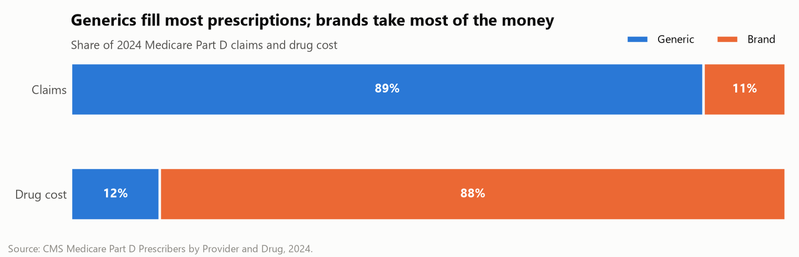
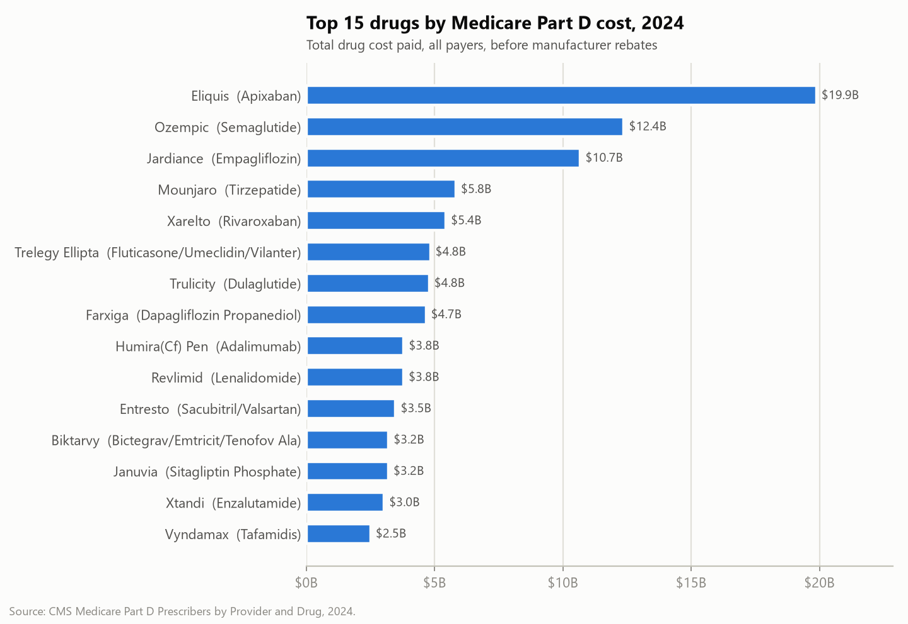
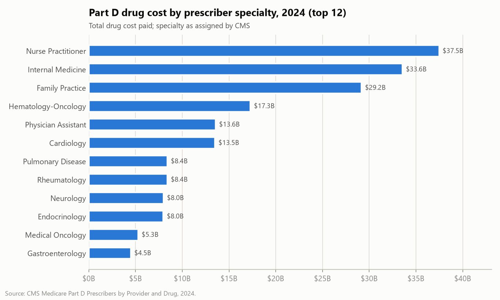
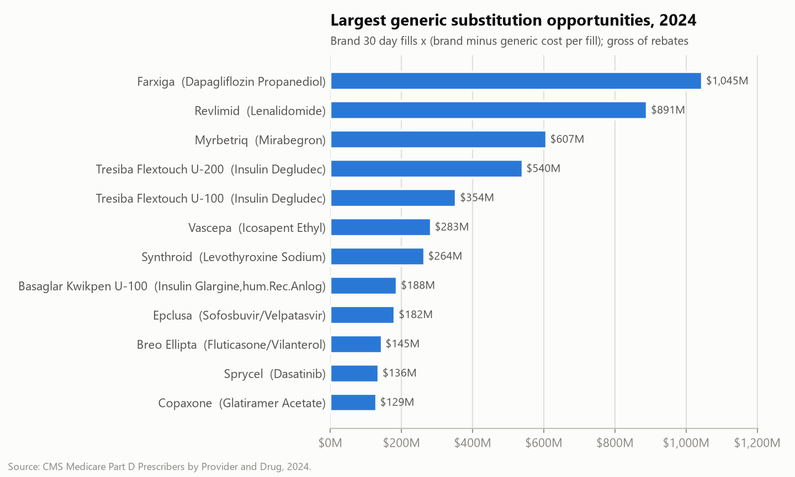
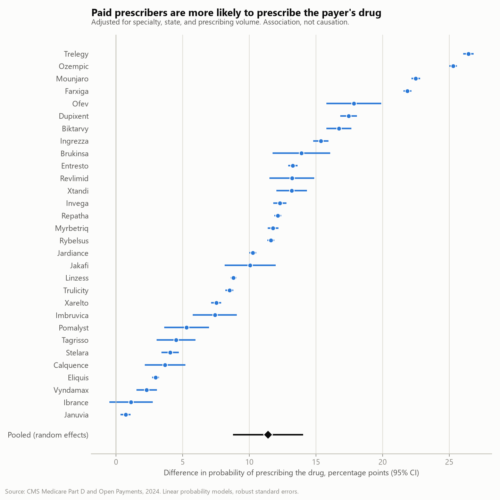
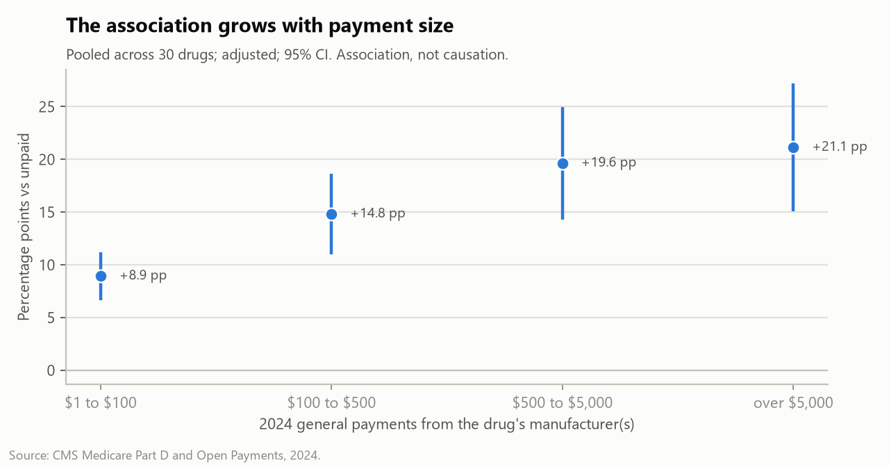
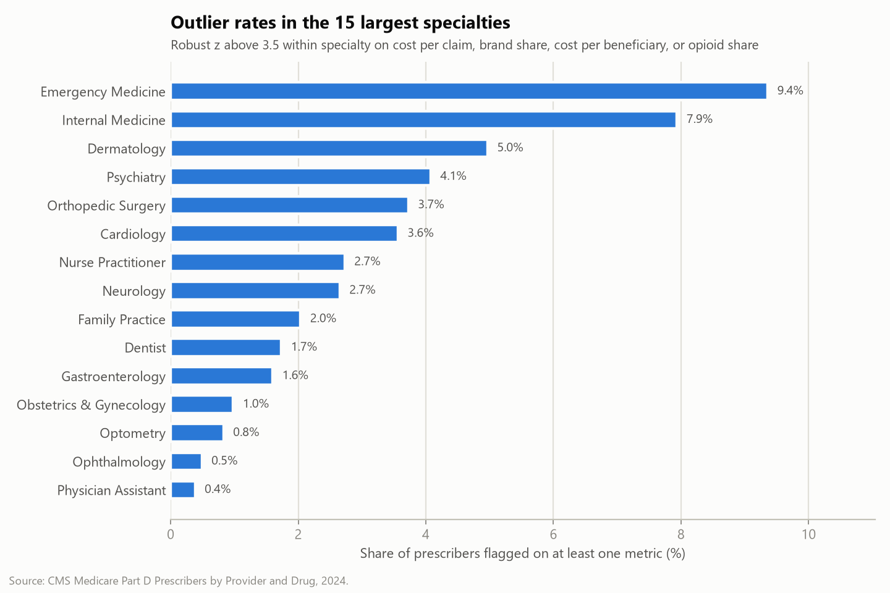

# Findings

Author: Erica Mathias

Results for the three RxLedger questions, using CMS Medicare Part D Prescribers by Provider and Drug (2024) and CMS Open Payments (Program Year 2024). Every number below is generated by the pipeline (`python run_pipeline.py`); public outputs are aggregated to drug, specialty, state, or manufacturer level.

<!-- summary:start -->
## Summary

- **Spend.** Medicare Part D paid $226.7 billion for 1.48 billion claims in 2024. Generics were 88.5% of claims but only 12.5% of cost, and the ten costliest drugs took 33.5% of all spending.
- **Generic substitution.** Dispensing an interchangeable generic in place of each brand would have saved an estimated $6.75 billion (gross, before rebates), after removing pairs that are not interchangeable from a formula upper bound of $10.71 billion.
- **Payments and prescribing.** Across the 30 biggest brand drugs, prescribers paid by the drug's manufacturer were 11.4 percentage points more likely to prescribe it (95% CI +8.8 to +14.0; matched comparison 10.1 percentage points), with a positive gap for 29 of 30 drugs. This is an association, not evidence of influence or wrongdoing.
- **Outliers.** 3.3% of 743,380 prescribers are unusual for their specialty on at least one metric and 0.81% on two or more; results are published only in aggregate.
<!-- summary:end -->

<!-- q1:start -->
## Question 1: Where does Medicare Part D drug money go?

Medicare Part D paid **$226.7 billion** for **1.48 billion claims** written by **1,139,455 prescribers** across 3,158 drug products (1,823 generic names) in 2024. Costs are gross: they include what plans, beneficiaries, and subsidies paid, before manufacturer rebates, which CMS does not publish at the drug level.

### Brand vs generic

Generics are **88.5% of claims but 12.5% of cost**. A brand claim cost $1,167 on average vs $22 for a generic claim.

The brand or generic label is derived from names (CMS publishes no flag). The strict rule (brand name equals generic name) would put generics at 79.1% of claims and 10.4% of cost, because many generic products carry a reformatted name (for example "Clopidogrel" for clopidogrel bisulfate). The rule used is documented in data_dictionary.md.

### Concentration in a few drugs

The top 10 drugs account for **33.5%** of all Part D cost. The three largest:

- **Eliquis** (apixaban): $19.88B, 8.8% of total, $864 per claim
- **Ozempic** (semaglutide): $12.38B, 5.5% of total, $1,246 per claim
- **Jardiance** (empagliflozin): $10.68B, 4.7% of total, $1,002 per claim

### Specialties and states

The five specialties with the most Part D cost:

| Specialty | Prescribers | Drug cost | Share of total | Brand share of cost |
|---|---:|---:|---:|---:|
| Nurse Practitioner | 229,976 | $37.5B | 16.5% | 87.0% |
| Internal Medicine | 104,182 | $33.6B | 14.8% | 84.3% |
| Family Practice | 105,120 | $29.2B | 12.9% | 82.8% |
| Hematology-Oncology | 8,746 | $17.3B | 7.6% | 89.3% |
| Physician Assistant | 114,276 | $13.6B | 6.0% | 87.6% |

Specialty totals mostly reflect headcount: Nurse Practitioner ranks first because 229,976 of them prescribe in Part D. Per prescriber, the highest cost specialties (among those with 1,000+ prescribers) are Hematology-Oncology ($1.98M), Rheumatology ($1.61M), Medical Oncology ($1.54M), driven by specialty drugs such as oral cancer and immunology therapies.

By state, California has the largest total ($21.3B). Among the 50 states and DC, brand share of cost ranges from 84.2% (Wyoming) to 91.1% (District of Columbia). State totals follow Medicare enrollment, so they are not per capita comparisons.

### Generic substitution savings

928 brand products share a generic name with at least one generic product in Part D. Together they cost $25.5B.

Method: for each such brand, savings = brand 30 day fills x (brand cost per 30 day fill minus the pooled generic cost per 30 day fill for the same generic name), floored at zero.

| Estimate | Savings |
|---|---:|
| Formula applied to every pair (upper bound) | $10.71B |
| Minus pairs judged not interchangeable on review | -$3.96B |
| **Reviewed estimate** | **$6.75B** |
| Reviewed, generic price based on 10,000+ fills only | $6.16B |

The reviewed estimate is about **3.0% of total Part D cost**.

Why a hand review: Part D has no dosage form or strength field, so a generic name group can mix forms. Long acting injections priced against oral tablets, extended release brands priced against immediate release generics, and inhalers priced against nebulizer solution all inflate the formula. The top 120 brands by upper bound savings (96% of the upper bound) were reviewed and 45 were excluded, with a written reason for each in `dbt/seeds/generic_substitution_exclusions.csv`. Excluded upper bound savings by reason:

- different strength or mixed forms: $1.91B
- different route: $0.90B
- extended vs immediate release: $0.67B
- different device: $0.48B

Limitations:

- **Gross cost, before rebates.** Brands with generic competition often carry large manufacturer rebates, so the net savings to Medicare would be smaller than shown.
- **Full substitution is not realistic.** Some patients need the brand (allergy to an inactive ingredient, narrow therapeutic index drugs, failed generic trials); the estimate is an opportunity size, not a forecast.
- **Pooled generic price.** The generic cost per fill averages all generic strengths and manufacturers for the generic name over all of 2024. For generics that entered the market recently, the 2024 generic price may still be high, which understates the gap.
- **Review depth.** Brands below rank 120 (4% of the upper bound) were not reviewed by hand and may include a few similar mismatches.

Outputs: `outputs_public/q1_*.csv`.
<!-- q1:end -->

<!-- q2:start -->
## Question 2: Are manufacturer payments associated with prescribing that manufacturer's drugs?

**Short answer: yes, consistently, but this is an association and not evidence of influence or wrongdoing.** Manufacturers target prescribers who already treat the relevant patients, so some or all of the gap can run in the opposite direction.

### Design

- **Drugs:** the 30 brand families with the most 2024 Part D cost that appear in Open Payments (for example Eliquis, Ozempic, Jardiance). Pen and syringe forms of one brand are grouped.
- **Population:** every Part D prescriber, whether or not they prescribe the drug, in the specialties that write 95% of its claims and where at least 1% of the specialty's prescribers use it (10,764 to 604,661 prescribers per drug). This keeps, for example, oncology drugs compared within oncology practice.
- **Treatment:** at least one 2024 general payment (any product: meals, travel, speaking, consulting) from a manufacturer that markets the drug.
- **Outcome:** whether the prescriber has 11 or more Part D claims for the drug (CMS hides 1 to 10), and log claims among those who do.
- **Controls:** specialty and state fixed effects, the prescriber's claims for all other drugs, and a beneficiary volume proxy.

### Results

Unadjusted, paid prescribers are more likely to prescribe the drug by a median of 19.9 percentage points across the 30 drugs. After adjustment the gap shrinks but stays positive: the adjusted difference is above zero (95% CI excludes zero) for **29 of 30 drugs**.

| Model (pooled across drugs, random effects) | Estimate | 95% CI | I² |
|---|---:|---:|---:|
| 1. Regression: probability of prescribing, paid vs unpaid | +11.4 pp | +8.8 to +14.0 | 99.9% |
| 1b. Same, also controlling for payments from other manufacturers | +11.9 pp | +9.3 to +14.6 | 99.9% |
| 1c. Same, treatment = payment naming the drug itself | +20.2 pp | +17.2 to +23.2 | 99.8% |
| 1d. Claims among prescribers of the drug (log scale) | +16.9% | +11.9% to +22.1% | 99.6% |
| 2. Matched comparison (specialty x state x volume decile) | +10.1 pp | +7.7 to +12.5 | 99.9% |

pp = percentage points. I² measures how much the drug level estimates differ beyond chance; high values mean the size of the association varies a lot by drug, so the pooled number is an average, not a constant.

The regression and the matched comparison agree (+11.4 pp vs +10.1 pp). Restricting the treatment to payments that name the drug itself gives a larger association (+20.2 pp), consistent with drug specific promotion being aimed at the prescribers most engaged with that drug. Among prescribers who do prescribe the drug, paid prescribers write about 17% more claims for it, after the same adjustments.

### Dose response

The gap rises with every step in payment size, from +8.9 pp for $1 to $100 to +21.1 pp for over $5,000. Each step's confidence interval overlaps its neighbor's, so the overall trend is clearer than any single step; the lowest and highest bins do not overlap.

| Payments from the drug's manufacturer(s) in 2024 | Prescriber x drug pairs | Difference vs unpaid | 95% CI |
|---|---:|---:|---:|
| $1 to $100 | 827,770 | +8.9 pp | +6.7 to +11.2 |
| $100 to $500 | 390,808 | +14.8 pp | +11.0 to +18.6 |
| $500 to $5,000 | 25,429 | +19.6 pp | +14.3 to +25.0 |
| over $5,000 | 8,708 | +21.1 pp | +15.1 to +27.2 |

A gradient is consistent with influence, but it is equally consistent with targeting: the prescribers a manufacturer most wants to reach (heavy prescribers in the therapeutic area) are also the ones invited to paid speaking and consulting roles.

### Caveats

- **Observational data.** No model here identifies a causal effect.
- **Reverse causality and targeting.** Manufacturers direct payments to prescribers who already treat the condition and already use the drug. The 2024 payments and 2024 prescribing are measured in the same year, so the order of events is unknown.
- **Unmeasured confounding.** Patient mix, practice setting, formulary access, and clinical interest are not observed. The specialty, state, and volume controls remove only part of it. Controlling for payments from other manufacturers (model 1b) moves the pooled estimate from +11.4 pp to +11.9 pp, so general industry engagement alone does not explain the gap.
- **Censoring at 11 claims.** CMS hides prescriber and drug pairs with fewer than 11 claims, so the outcome is "prescribes at a visible level", not any use.
- **Treatment is broad.** A payment from Pfizer counts for Eliquis even if the meal promoted another Pfizer product (model 1c narrows this to payments naming the drug). Most payments are small meals (food and beverage is over 90% of general payment records).
- **Name matching.** Drugs link across datasets by normalized brand name (93.5% of drug product rows matched); see data_quality_report.md.
- **Payments are legal and disclosed.** Industry payments for meals, education, consulting, and research are lawful and publicly reported. **A correlation between payments and prescribing is not evidence that any individual prescriber acted improperly**, and no individual is identified in this project.

Outputs: `outputs_public/q2_*.csv` (drug level and pooled results only).
<!-- q2:end -->

<!-- q3:start -->
## Question 3: Which prescribers are statistical outliers within their specialty?

**Only aggregate results are published.** Individual flags stay in a local, git-ignored folder. An outlier here means a prescribing pattern that is unusual for the prescriber's specialty label. It is not a finding of fraud, waste, or poor care: a subspecialist, a hospice or oncology focused practice, or a clinic serving very sick patients will look unusual by design.

### Method

- **Population:** 743,380 Part D prescribers with at least 100 claims, in 76 specialties with at least 100 such prescribers.
- **Metrics:** cost per claim, brand share of claims, cost per beneficiary (proxy, using only drug rows where CMS did not suppress beneficiaries), and opioid share of claims (buprenorphine excluded because it mostly treats opioid use disorder).
- **Robust z score** within specialty: 0.6745 x (value minus specialty median) / median absolute deviation. Flag when above 3.5 (high side). Median and MAD are not pulled around by the extremes the way a mean and standard deviation are.
- **Scales.** Costs are scored on a log scale and shares on an arcsine square root scale. On the raw scale, a specialty whose median opioid share is under 1% would flag anyone above about 5%, which is not unusual in practice.
- **Isolation Forest** per specialty on the same four metrics (fixed seed, top 1% most isolated), as a second, multivariate opinion.

### Results

3.3% of analyzed prescribers are flagged on at least one metric and **0.81% on two or more**.

| Metric | Prescribers scored | Flagged | Rate | Specialties not scored (MAD = 0) |
|---|---:|---:|---:|---:|
| Cost per claim | 743,379 | 10,400 | 1.4% | 0 |
| Brand share of claims | 638,517 | 10,873 | 1.7% | 21 |
| Cost per beneficiary (proxy) | 712,487 | 8,010 | 1.1% | 0 |
| Opioid share of claims | 267,207 | 1,551 | 0.6% | 44 |

The Isolation Forest flagged 7,461 prescribers; 63% of them are also flagged by the robust z rule, and 41% of the prescribers flagged on two or more metrics are also isolated by the forest. Agreement between a univariate and a multivariate method makes the multi metric flags the most robust group.

Ten largest specialties:

| Specialty | Prescribers | Median cost per claim | Median brand share | Flagged (any) | Flagged (2+) |
|---|---:|---:|---:|---:|---:|
| Nurse Practitioner | 170,374 | $62 | 6.4% | 2.7% | 0.33% |
| Family Practice | 91,869 | $66 | 7.3% | 2.0% | 0.44% |
| Internal Medicine | 79,263 | $73 | 8.5% | 7.9% | 1.96% |
| Physician Assistant | 78,773 | $42 | 4.3% | 0.4% | 0.01% |
| Dentist | 27,191 | $4 | 0.0% | 1.7% | 0.79% |
| Emergency Medicine | 18,389 | $7 | 0.0% | 9.4% | 6.05% |
| Cardiology | 17,764 | $183 | 16.1% | 3.6% | 1.24% |
| Ophthalmology | 16,156 | $74 | 7.7% | 0.5% | 0.06% |
| Psychiatry | 15,993 | $51 | 2.0% | 4.1% | 0.10% |
| Optometry | 15,087 | $91 | 10.3% | 0.8% | 0.20% |

Among specialties with 10,000+ prescribers, the highest flag rates are in Emergency Medicine (9.4%, median cost per claim $7) and Internal Medicine (7.9%, median cost per claim $73). These labels cover very different practices (an emergency medicine clinician who also manages chronic disease, an internist who mainly treats cancer or HIV), so the flags mostly mark practices that do not fit the label rather than unusual prescribing for the patients actually seen.

By state (50 states and DC), the share of prescribers flagged on at least one metric ranges from Wyoming 1.6%, North Dakota 1.9%, Idaho 2.1% at the low end to District of Columbia 6.5%, Massachusetts 4.8%, New York 4.5% at the high end. Flags are computed within specialty nationally, so state differences reflect practice patterns, payer mix, and patient populations, and are descriptive only.

### Caveats

- **Specialty labels are coarse.** CMS assigns one specialty per NPI; an internist who mostly treats cancer or HIV is compared with general internists.
- **Patient mix is unobserved.** Higher cost or brand share can be clinically appropriate (sicker patients, newer guideline therapies, prior generic failure).
- **Suppression.** Drug rows with fewer than 11 claims are not in the data, and the cost per beneficiary proxy uses only rows with unsuppressed beneficiary counts.
- **Threshold choice.** The 3.5 cutoff is a common convention, not a law; rates scale with it. Results are a screening view for where to look, not a list of wrongdoers.
- **Privacy.** Public tables suppress any count from 1 to 10 and any group with fewer than 11 prescribers. No prescriber is named anywhere in this repository.

Outputs: `outputs_public/q3_*.csv` (specialty, state, and overall aggregates).
<!-- q3:end -->
